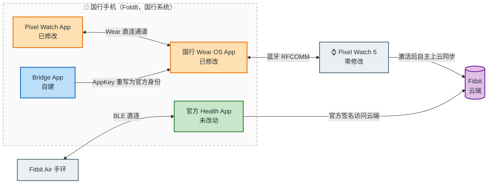

# Pixel Watch 国行适配：配对、迁移与 Fitbit 同步的完整逆向工程记录

> **Pixel Watch 在国行手机上能用吗？——能，无 root、国行系统原样保留。**
> 本仓库记录在国行三星手机（Galaxy Fold8）上完整使用 Pixel Watch 5 的过程：配对（解决 `UNSUPPORTED_PLATFORM`）、从另一台手机带账号迁移（phone switching）、手表端 Fitbit 应用激活与健康数据云同步。配套文档覆盖国行 Wear OS（`com.google.android.wearable.app.cn`）架构与签名校验（AppKey）机制、配对与跨手机迁移协议、Fitbit 同步协议，以及 apktool / jadx / smali 逆向修改方法。
>
> 本仓库只包含文档：不含反编译代码、修改后的 APK 或补丁文件。

## 1. 背景

我在中国大陆使用国行三星手机（Galaxy Fold8），想完整使用 Google 穿戴设备。先买的 Fitbit Air 手环（无屏幕款）体验一周完全正常——它走 BLE 直连和自有云，不依赖 Wear 生态。随后入手 Pixel Watch 5，官方 Pixel Watch App（`com.google.android.apps.wear.companion`）配对直接失败，错误 `UNSUPPORTED_PLATFORM`。

名称对照（手机上两个应用分别显示为 **Watch** 和 **Health**）：

| 名称 | 是什么 |
|---|---|
| **Pixel Watch 5** | 手表（Google 硬件），文中"手表"均指它 |
| **Fitbit Air** | 无屏幕手环（Fitbit 硬件） |
| **Watch** | 手机端手表管理应用，即 Google Pixel Watch App（`com.google.android.apps.wear.companion`） |
| **Health** | 手机端健康管理应用，即 Fitbit 应用（`com.fitbit.FitbitMobile`），查看手表/手环数据 |
| 国行 Wear OS App | 系统内置服务应用（`com.google.android.wearable.app.cn`），本项目的主要修改对象 |
| Bridge | 桥接应用，本项目自行实现（见 docs/05） |

诊断确认了根本原因（详见 [docs/01](docs/01-why-cn-blocks-wear.md)）：

1. **GMS 平台级功能开关**：国行设备的 GMS 内 WearableService 整体不可用，任何调用方（包括官方签名的 App）请求 Wear 服务都会得到 `Wear is not available on this device. Calling package: ...`。这一层在 GMS 进程内，无 root 不可修改。
2. **国行 Wear OS App 的调用方签名校验**：国行手机系统内置的 `com.google.android.wearable.app.cn` 拥有功能完整的 Wear 服务协议栈（配对管理、RFCOMM 传输、节点路由、消息通道、配置数据库），是 Google 为国行生态单独维护的版本，但只接受 Google 官方签名的调用方。修改它就必须重签名，而重签名会使包内所有"包名 + 证书摘要"校验失败。
3. **手表侧 AppKey 校验**：手机发往手表的每条消息都携带 AppKey（包名 + 签名摘要），手表只接受官方组合，不匹配时静默丢弃（手表日志 `Mismatched certificate: AppKey[...]`）。

## 2. 方案

整体思路：不修改 GMS 与手表（两者不可改也不需要改），把通信全部改到国行 Wear OS App 这条可修改的通道上，并让重签名后的各方通过签名校验。手表初始化在另一台刷了港版固件的三星 S22 上完成（国行环境无法走到初始化步骤；S22 是备用机，主力机不能刷机，原因见 FAQ）。

四个阶段：

**配对打通。** Pixel Watch App 原生内置"中国模式"——检测到官方签名的国行 Wear OS App 时切换到 `.cn` 直连通道。重签名使检测必然失败，故将该检测改为恒定启用；同时在国行 Wear OS App 侧放行我们的调用方包名、替换自检证书摘要、在配置表为空时自举建配置（官方流程中配置由国行 Wear OS 手机端创建，本机没有）；配对向导中引用了国行版本不存在的服务端接口（如新版条款 API）的步骤，利用引擎自带的"步骤不可用即跳过"机制跳过。

**跨手机迁移（phone switching）。** 迁移是官方"换手机"功能，手表可带着账号从 S22 迁到 Fold8。国行服务端禁用了该功能，链路上需要逐层处理（完整分析见 [docs/04](docs/04-pairing-and-migration.md)）：发现阶段的换机 feature 查询、服务端迁移配置准入（`4014 FEATURE_DISABLED`）、握手迁移标志位核对、账号匹配（GMS 账号 provider 被签名校验拒绝后改用 `AccountManager` 直查，匹配失败路径绕开会崩溃的选账号 UI）。完成后 `onMigrationSucceeded`，手表自动断开旧手机，账号保留。

**Fitbit 激活。** 配对后手表端 Fitbit 应用处于未登录锁定态，等待手机侧发送激活消息（`/auth/request`，auth:1.2 协议，载荷为混淆账号标识）。但官方 Health App（`com.fitbit.FitbitMobile`）管理 Wear 设备走 GMS broker 通道，在国行被第 1 条障碍拒绝；它内置的 CN 双模检测又要求国行 Wear OS App 为官方签名，与我们的重签名版互斥。解法是自己写一个桥接 App（Bridge）：纯 Java Binder 直连国行 Wear OS App 的 WearableService（不拷贝任何官方代码，25KB、零依赖），并利用国行 Wear OS App 侧的 AppKey 重写，把 Bridge 的出站身份映射为官方 Fitbit App（官方包名 + 官方 lineage 祖先证书摘要）。手表无需任何修改，激活消息送达后手表端 Fitbit 正常登录。

**同步闭环。** 关键事实：同步数据不经过手机——手表激活后自身具备完整的云端同步能力（前提是手表有可访问 Fitbit 云端的网络环境，此为先决条件，不在本文范围）。手机侧只需触发（`/sync/v1/request/schedule`）与展示状态。Pixel Watch App 手表页常驻的"正在同步…"是其本地状态机等待服务端回调所致，Bridge 实现了该回调协议后状态恢复正常。官方 Health App 保持原版不动，从云端查看手表与手环数据。

最终架构：

## 3. 结果

| 能力 | 状态 |
|---|---|
| Pixel Watch 5 与国行手机配对、蓝牙常连 | ✅ |
| 从另一台手机带账号迁移（phone switching） | ✅ |
| 手表端 Fitbit 应用激活、登录 | ✅ |
| 手表健康数据同步上云（心率/步数/睡眠） | ✅ 蓝牙实测正常 |
| 手机端官方 Health 查看手表 + 手环数据 | ✅ 官方原版，未改动 |
| 表盘、通知、设置等系统功能 | ✅ |

## 4. 文档

| 文档 | 内容 |
|---|---|
| [01 - Pixel Watch 国行为什么配对失败](docs/01-why-cn-blocks-wear.md) | GMS 平台限制（`Wear is not available`）、双 WearableService 架构、三层障碍定位、环境自检 |
| [02 - Android APK 逆向方法](docs/02-methodology-smali-patching.md) | apktool / jadx 工具链、smali 最小补丁循环、补丁类型、日志系统、十条经验教训 |
| [03 - Wear OS 签名校验与 AppKey 协议](docs/03-signature-trust-and-appkey.md) | AppKey 机制、10 个校验点清单、`Mismatched certificate` 排查、v3 lineage 摘要取值 |
| [04 - Wear OS 配对流程与跨手机迁移协议](docs/04-pairing-and-migration.md) | 配对步骤引擎、连接建立链路、phone switching 逐层分析、连接状态码字典 |
| [05 - Pixel Watch 的 Fitbit 应用激活与同步协议](docs/05-fitbit-activation-sync-bridge.md) | 激活协议（auth:1.2）、消息路径表、同步触发语义、Binder 直连与 SafeParcel 要点 |

**版本基线**（补丁位置与版本强相关，复现时请对照）：Pixel Watch App 5.1.0.x / 国行 Wear OS App 2.68.201.x / Health (Fitbit) 5.10.1 / 2026-10 时点的手表固件。混淆类名随版本变化，文档一律用行为描述 + 可观测特征（日志字符串、错误码、adb 命令）定位，不依赖具体类名。

**投入**：约一周高强度迭代（含一次因日志打点位置错误导致的整体重做），40+ 轮构建装机循环，约 25 个有效补丁，10 组日志打点。

## 5. FAQ

**为什么不把主力机（Fold8）刷成港版或国际版系统？为什么不 root？**
两者都会失去 eSIM：国内运营商营业厅只给国行手机 + 国行系统的设备办理 eSIM 业务，刷机或解锁（熔断 Knox）后主力机的 eSIM 就废了。而且实测不 root、不刷机也能走通——三层障碍里有两层位于可修改的普通 App（国行 Wear OS App）内。S22 是备用机、不装 eSIM，所以可以刷港版固件用于手表初始化。

**官方 App 更新后怎么办？**
补丁基于特定版本的反编译结果，更新后需要按 docs/02 的方法重新定位。锚点会变，流程不变。

**其他手表 / 其他国行手机适用吗？**
方法论通用；具体补丁点取决于 App 版本。核心结论——国行 Wear OS App 自带完整服务栈、AppKey 运行时摘要取 lineage 祖先证书——在任何国行 Wear 场景都成立。

**手表侧有修改吗？**
没有。手表始终认为自己在与官方 App 通信，可正常接收系统更新。

**合法性？**
见下方声明。

## 6. 声明

- 本仓库仅包含技术文档，不提供、日后也不会提供任何修改后的 APK、补丁文件或下载链接。
- 所有分析均为个人出于设备互操作性研究目的进行的学习行为。相关商标与软件著作权归各自所有者；Google、Fitbit、Samsung 与本项目无任何关联。
- 逆向工程在不同司法辖区的法律边界不同（合同条款、反规避条款等），请读者在动手前自行确认所在辖区的规定，并对自己的行为负责。
- 本文档不讨论任何网络访问手段；手表云端同步以其自身网络环境可用为前提，如何获得不在本文讨论范围。
- 依本文档操作产生的一切后果（设备损坏、数据丢失、账号风险）由操作者自行承担。

---

*如果这个项目对你有帮助，欢迎 star；技术讨论欢迎开 issue，但请勿索要或分享修改后的安装包。*
